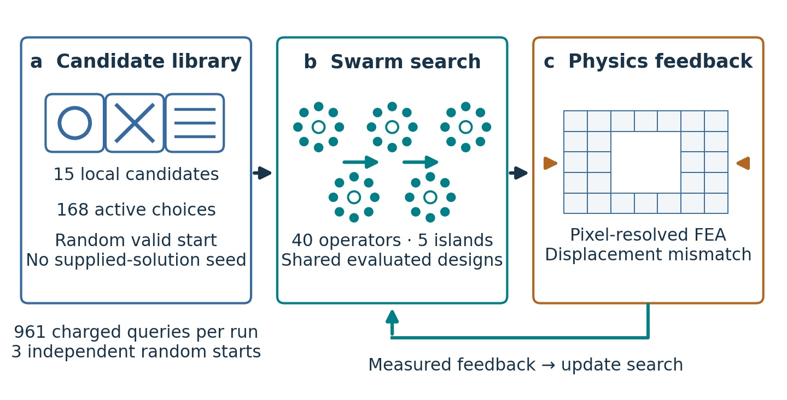
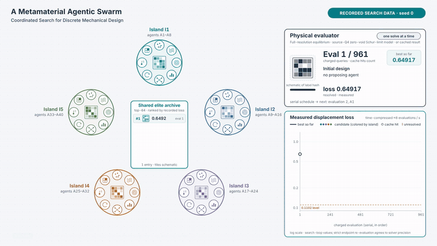
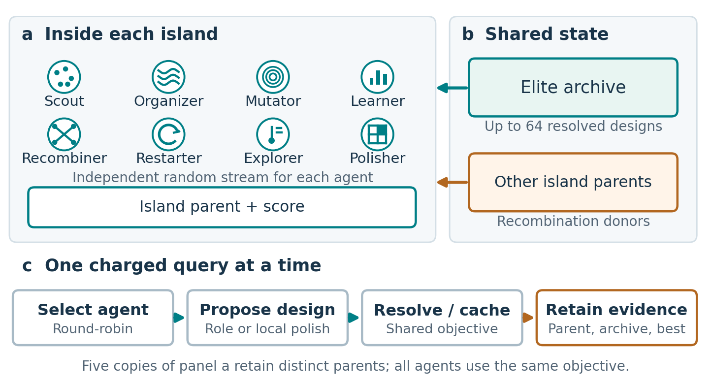

# Clockwork: exact 961-query swarm study

**A Metamaterial Agentic Swarm: Coordinated Search for Discrete Mechanical Design**

Authors: Liwei Wang and Amir Barati Farimani (corresponding author).

- [Current manuscript PDF](clockwork-961-paper.pdf)
- [Editable Overleaf/LaTeX, seven figure sets and plotting sources](clockwork-961-overleaf.zip)
- [Frozen optimizer/solver sources and recorded swarm validation](clockwork-961-code-and-validation.zip)
- [File checksums](CLOCKWORK-961-MANIFEST.json)
- [Working Overleaf project](https://www.overleaf.com/project/6add38d3993ecc93348e8b2e)

## Animated explanation

[Full film (MP4, 59.5 s)](https://github.com/BaratiLab/Metamaterial-Swarm/raw/refs/heads/main/metamaterial_swarm.mp4) · [Compact WebM preview](metamaterial_swarm_preview.webm) · [Editable interactive project](metamaterial_swarm_project.zip) · [Video documentation](SWARM-VIDEO.md)

The movie, created with Claude, shows forty numerical agents, island parents,
shared elite memory, and serial evaluation. Recorded seed-0 counters, proposing
agents, losses, unresolved outcomes, cache flags, and best-so-far history use the
961-event record. Parent tiles, donor choices, and communication choreography
are explicitly illustrative because complete parent/donor lineage was not logged.
Only seed 0 reaches 0.1102; no comparative or causal coordination benefit is claimed.
The film uses a seekable HTML composition rendered with Chromium and ffmpeg;
HyperFrames itself was not installed in its build environment.

## Agent responsibilities and cooperation

Clockwork has five island states and forty numerical search agents. Each island
contains the same eight specialties: global scout, spatial organizer, multiscale
mutator, archive learner, recombiner, diversity restarter, neighborhood explorer,
and incumbent polisher. Islands have separate parents and random streams, not
different engineering disciplines. Complete designs and scores are shared through
an elite archive and recombination. Physical evaluations are serial; forty logical
agents do not imply forty parallel solves. These agents are numerical policies,
not language models. The manuscript maps every agent to its responsibility and
explains the actual interleaved local-polishing schedule.

## Strictly validated endpoints

| Seed | Physical displacement loss at 961 charged queries |
|---|---:|
| 0 | 0.10058956169534036 |
| 1 | 0.13927377000061084 |
| 2 | 0.13585832998446776 |
| Mean | 0.125240553893473 |

The best loss is 0.00961043830465964 below 0.1102 (8.7209% below; ratio
0.9127909409740504). One of three seeds reaches that value. Three seeds are
descriptive. Strict endpoint solves use relative residual tolerance 1e-10, and
fixed-design field recovery reproduces the archived endpoint losses. Geometry
certificates and stress-recovery checks are included in the recorded evidence.
The plots include designs, both displacement components and magnitude, all
in-plane stress components, von Mises stress, and in-plane principal stresses.
Local stress maxima are not mesh-converged peak estimates.

## Scope and accounting

This manuscript reports the numerical swarm study. It does not report comparator
performance or claim a causal benefit from communication. There are 2,883 cumulative swarm queries
(three times 961), including 1,080 after the 601-query checkpoints. The records
include 205 unresolved queries and 32 charged cache hits; these categories can
overlap. Exact skipped-duplicate counts and wall time at 961 are not recoverable;
the duplicate-count placeholder is not a measured zero.

The endpoint is a retrospective amendment of a continuation toward 1201 queries,
not a completed 1201 protocol. Only events through query 961 define these designs.
No supplied optimized assignment guided the recorded search. No new optimization
or equilibrium solves were launched for this repository update.

## Verification and reproduction limits

Extract the code/validation ZIP and run `python verify_records.py` for a read-only
artifact consistency check. It does not rerun finite elements. The original input
library, observation masks and reference field are required separately and are
not redistributed. Full raw nodal-field caches are not included in this upload;
the field figures and validation summaries are included. The field plotting script
in the Overleaf package requires those external saved fields to regenerate maps.
No clean-environment scientific replay is claimed.

Compile `main.tex` inside the extracted Overleaf ZIP with pdfLaTeX, preserving its
`figures/` directory. Figure 1 is in the introduction (page 2) and Figure 2 opens
the swarm-methods section (page 5). The current draft has 20 pages and resolved
cross-references. Author declarations remain pending; mesh/void-contrast
sensitivity, broader test cases, and controlled agent/communication ablations are
research gaps before stronger general claims or submission readiness.
