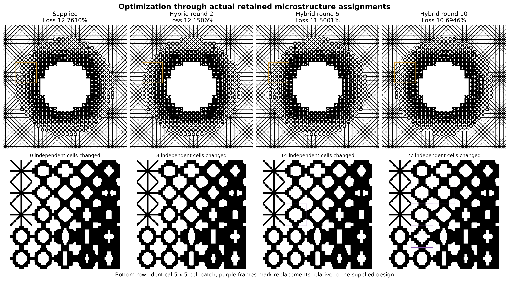
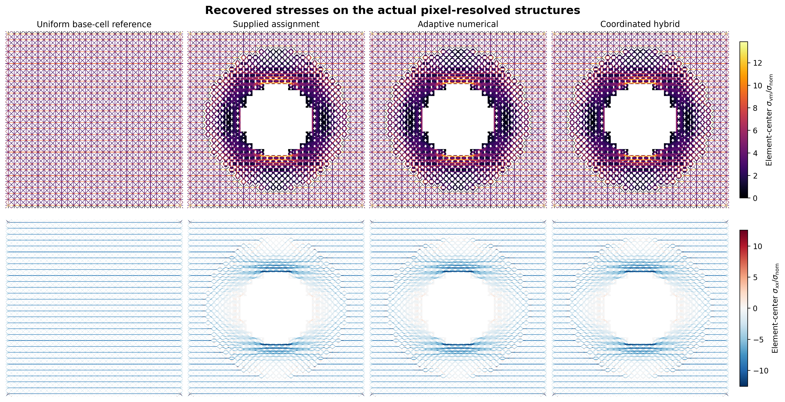
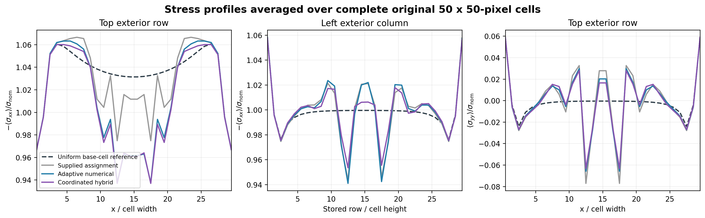

# Metamaterial Swarm

Physics-guided multi-agent selection of heterogeneous mechanical metamaterials, evaluated with full-resolution finite elements.


A numerical proposer calibrates surrogate scores and nominates a repair. A response specialist composes useful changes and tests ablations; an interface specialist explores compatible neighboring cells. Coordination enforces valid, distinct assignments before evaluation. The finite-element solver measures the objective, and only lower measured loss replaces the incumbent.

## Mechanical-cloaking benchmark

The domain contains 2.25 million Q4 elements, 168 independent selectable cells, and 15 local candidates per cell. Mirror symmetry reduces the solve while preserving the original pixel resolution. Adaptive numerical search and the coordinated hybrid start from the same supplied assignment and identical 18-trial historical ledger. Each receives 30 distinct new FEM evaluations in ten rounds of three.

| Method | Final masked displacement loss | Reduction from supplied assignment |
| --- | ---: | ---: |
| Supplied assignment | 12.7610% | — |
| Adaptive numerical search | 11.6308% | 8.86% |
| Coordinated hybrid | **10.6946%** | **16.19%** |

The hybrid's final loss is 8.05% lower than this numerical comparator's. All 60 candidate evaluations passed the recorded force-residual checks. Final element-force and reaction checks passed, and both retained structures have one connected solid component.


This is one exploratory case with historical knowledge and a fixed numerical comparison policy. Equal FEM counts do not imply equal token, latency, or computation budgets. The experiment does not establish general LLM superiority or isolate the causal effect of coordination. A matched uncoordinated control, GNN comparison, held-out cases, and manufacturing validation remain outside the reported study.

## Structures and stress fields







The figures use original pixel geometries and saved fine displacement fields. Stress recovery uses Q4 element-center strains and passes stiffness-quadrature and affine-patch checks. Local fields use common color limits with disclosed saturation. The fixed-exterior tensor mismatch is 11.6298% for the supplied assignment, 11.8811% for numerical search, and 11.5985% for the hybrid. Stress is a secondary diagnostic, not the optimized objective; the displacement improvement does not imply a comparable stress improvement.

## Paper, code, and data

Authors: **Liwei Wang** and **Amir Barati Farimani** (corresponding author).

- [Paper](metamaterial-swarm-paper.pdf) and [LaTeX source](main.tex).
- [Manuscript package](overleaf-metamaterial-selector.zip): compile `main.tex` with pdfLaTeX, keeping the two required PNG figures alongside it.
- [Scientific source and results](Metamaterial-Swarm-source-and-results.zip), with file checksums in [MANIFEST.json](MANIFEST.json).
- [Cloaking code and recorded evaluations](cloak-coordination-results.zip) and [results report](COORDINATION-RESULTS.md).
- [Publication figures and profile data](paper-figures.zip).
- Algorithm overview: [SVG](figure1-coordinated-workflow.svg), [PDF](figure1-coordinated-workflow.pdf), and [PNG](figure1-coordinated-workflow.png).

The source archive preserves the project directory structure:

| Directory | Contents |
| --- | --- |
| `outputs/cloak-coordination/` | Primary matched-budget comparison, selectors, proposal records, validation, retained labels, and replay |
| `outputs/cloak-experiment/` | Preliminary cloak experiment and numerical checks |
| `outputs/cloak-review/` | Supplied-package adapter, MATLAB wrapper, and geometry checks |
| `outputs/metamaterial-selector/` | Supporting beam benchmark and public unit-cell data |
| `outputs/overleaf-metamaterial-selector/` | Manuscript source and supporting results |
| `outputs/paper-figures/` | Figure source, profile data, and stress-recovery validation |
| `work/` | Scientific plotting, evaluation, and validation utilities |

Rendered figures and the paper PDF are supplied in their separate archives. Installed runtimes and large displacement caches are excluded.

## Reproduction

The original `Agent_Meta` input folder supplied by Liwei Wang is required separately and is not redistributed. Use Python 3.11 with `outputs/cloak-coordination/requirements.txt` in an isolated environment. From the extracted `outputs/cloak-coordination/` directory:

```bash
OPENBLAS_NUM_THREADS=1 OMP_NUM_THREADS=1 python replay_actions.py \
  --package /absolute/path/Agent_Meta --out /absolute/path/new-replay
```

The replay recomputes the 60 recorded proposals with fresh FEM solves. It does not regenerate LLM decisions. Use a fresh output directory and consult `REPRODUCE.txt` for the inputs, dependencies, and cache conventions. The complete replay entry point has not been independently rerun through all 60 cases; the original evaluations and validation records are included.

Hybrid choices were assistant-mediated. Exact model snapshot and decoding settings were not recorded, so the literal proposals and measured outcomes are more reproducible than regeneration of the language-agent decisions. Stress postprocessing additionally requires the corresponding saved displacement fields.

## Supporting studies and attribution

The preliminary nine-evaluation cloak comparison favored numerical search: 12.3594% versus 12.5406% for the swarm. Its 18 outcomes initialize both primary methods. The beam study includes an unsuccessful initial language-guided repair and a later common-incumbent comparison; its objective and protocol differ from the cloaking benchmark.

The public microstructure library is by Liwei Wang, Jagannadh Boddapati, Ke Liu, Ping Zhu, Chiara Daraio, and Wei Chen, *2D orthotropic metamaterial micorstructrue dataset*, [Figshare version 1](https://doi.org/10.6084/m9.figshare.17141975.v1), CC BY 4.0. Dataset metadata and checksums are included.

Related design frameworks: [Wang et al., CMAME 372 (2020), 113377](https://doi.org/10.1016/j.cma.2020.113377) and [Wang et al., PNAS 119 (2022), e2122185119](https://doi.org/10.1073/pnas.2122185119). The comparison here does not claim to beat those published designs. Author-supplied inputs and private correspondence are excluded. No blanket software license is assigned by this distribution.
