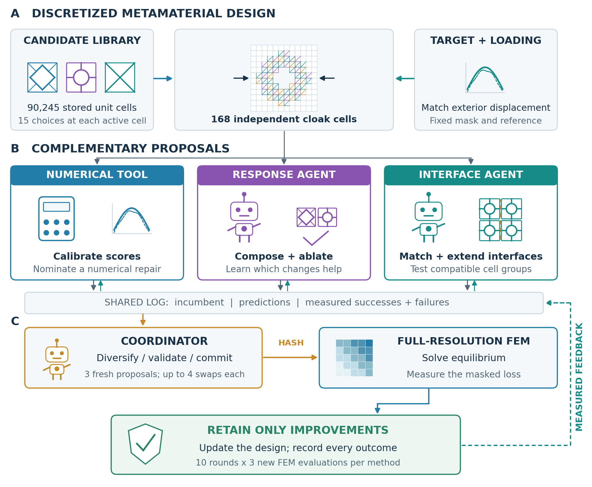
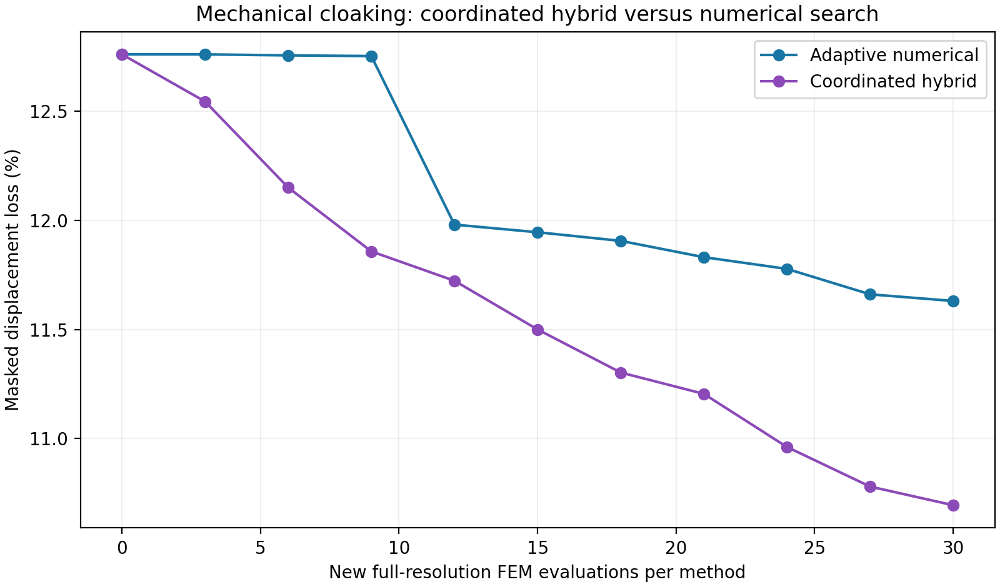

# Metamaterial Swarm

Coordinated language agents and numerical tools for discrete metamaterial assembly, validated by full-resolution finite elements.



The **numerical tool** calibrates surrogate scores and proposes a repair. The **response agent** composes helpful changes and tests ablations. The **interface agent** explores compatible neighboring cells. The **coordinator** resolves duplicates, checks actions, and commits three proposals before FEM evaluation. The shared log records every success and failure; only lower measured loss can replace the incumbent.

## Completed mechanical-cloaking experiment

Both methods restart from the supplied assignment and receive the same 18-trial historical ledger. Each gets **30 distinct new full-resolution FEM evaluations**, in ten rounds of three.

| Method | Final masked displacement loss | Reduction from supplied assignment |
| --- | ---: | ---: |
| Supplied assignment | 12.7610% | — |
| Adaptive numerical search | 11.6308% | 8.86% |
| Coordinated hybrid | **10.6946%** | **16.19%** |

The hybrid final loss is **8.05% lower** than this numerical comparator's. The problem has 2.25 million Q4 elements, 168 independent selectable cells, and 15 local candidates per cell. Exact mirror reduction retains the original pixel resolution. All 60 new solves passed force-residual checks; final element-force and reaction checks passed. Both final assemblies have one connected solid component.



This is one exploratory case with historical knowledge, a fixed numerical policy, and adaptive assistant-mediated decisions. It does not establish general LLM superiority or isolate coordination causally. A matched uncoordinated swarm control, GNN comparison, held-out cases, repeated-model trials, manufacturing validation, and matched token/wall-clock costs have not been run.

## Paper and figures

- [Rewritten manuscript PDF](metamaterial-swarm-paper.pdf)
- [Standalone LaTeX source](main.tex): embeds all manuscript diagrams and plots; compile with pdfLaTeX without external graphics or BibTeX.
- [Overleaf-ready package](overleaf-metamaterial-selector.zip)
- Editable Figure 1: [SVG](figure1-coordinated-workflow.svg), [PDF](figure1-coordinated-workflow.pdf), [PNG](figure1-coordinated-workflow.png).
- [Detailed coordination report](COORDINATION-RESULTS.md)
- [Coordination code, actions, validation, and results](cloak-coordination-results.zip)

The manuscript centers on cloaking, with the earlier beam study as supporting evidence. Author identities and journal declarations remain deferred and must be completed before submission. This private repository is a working research record, not a permanent public archive.

## Complete source distribution

Download [Metamaterial-Swarm-source-and-results.zip](Metamaterial-Swarm-source-and-results.zip) and extract it. The original structure is preserved, including all project-authored Python/MATLAB code, recorded proposals, outcomes, figure-generation source, and rewritten paper. [MANIFEST.json](MANIFEST.json) lists every archived file and SHA-256 checksum. Installed third-party runtimes and large displacement caches are excluded.

| Extracted directory | Contents |
| --- | --- |
| `outputs/cloak-coordination/` | Primary 30-versus-30 study, coordinator, numerical selector, all 60 trials, hashes, retained MAT labels, validation, and replay |
| `outputs/cloak-experiment/` | Earlier nine-versus-nine study, failures, and disclosed policy development |
| `outputs/cloak-review/` | Supplied-package adapter, audit, and MATLAB wrapper |
| `outputs/metamaterial-selector/` | Supporting beam benchmark, public data, proposals, and verification |
| `outputs/overleaf-metamaterial-selector/` | Rewritten standalone manuscript and supporting evidence |
| `outputs/paper-figures/` | Editable overview scene, TikZ, SVG/PDF/PNG, and result figures |
| `work/` | Project-authored generation, audit, and exploratory utilities; historical scripts may retain original-machine paths |

## Reproduce saved decisions

The original `Agent_Meta` input folder supplied by Liwei Wang is required separately and is **not redistributed**. Use Python 3.11 and `outputs/cloak-coordination/requirements.txt` in an isolated environment. From that extracted directory:

```bash
OPENBLAS_NUM_THREADS=1 OMP_NUM_THREADS=1 python replay_actions.py \
  --package /absolute/path/Agent_Meta --out /absolute/path/new-replay
```

This recomputes 60 saved proposals with fresh large FEM solves, without generating new LLM decisions. The replay entry point was supplied after the study and has not been redundantly rerun through all 60 assessments. Original executed evaluations, audit, and force-balance checks are preserved. See `REPRODUCE.txt`; use a fresh output directory.

Exact model snapshot and decoding settings were not captured. Literal actions, reasons, and numerical outputs therefore have a stronger reproducibility basis than regeneration of language-agent decisions. This is a research implementation, not an unattended LLM API service.

## Earlier findings and attribution

The preliminary cloak experiment favored numerical search: 12.3594% versus 12.5406% for the swarm at nine evaluations each. All 18 outcomes initialize both primary methods. The supporting beam study includes a failed initial language-guided repair and a later common-incumbent competition; its objective and protocol differ from the cloak comparison.

The public library is by Liwei Wang, Jagannadh Boddapati, Ke Liu, Ping Zhu, Chiara Daraio, and Wei Chen, *2D orthotropic metamaterial micorstructrue dataset*, [Figshare version 1](https://doi.org/10.6084/m9.figshare.17141975.v1), CC BY 4.0. Metadata and checksums are retained. We thank Liwei Wang for the separate cloak assignment, evaluator, and summary; this does not imply endorsement of the new claims.

Related papers: [Wang et al., CMAME 372 (2020), 113377](https://doi.org/10.1016/j.cma.2020.113377); [Wang et al., PNAS 119 (2022), e2122185119](https://doi.org/10.1073/pnas.2122185119). We do not claim to beat their published designs. Private correspondence and author-supplied inputs are excluded. No new blanket software license is assigned by this snapshot.
