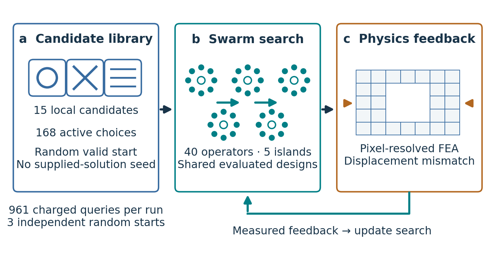
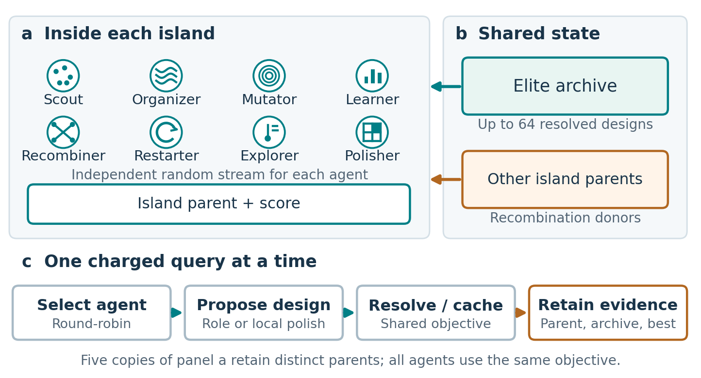
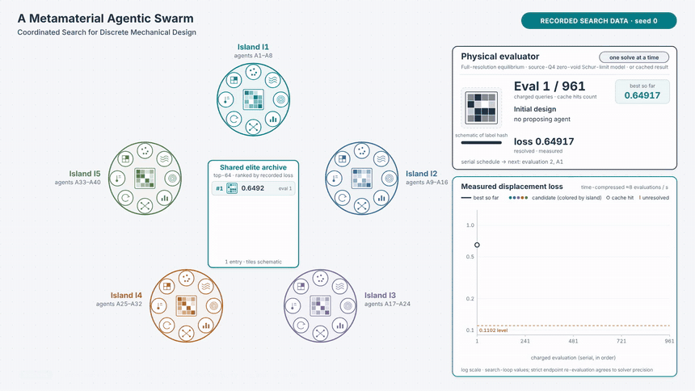

# Metamaterial Swarm

## Current manuscript: exact 961-query metamaterial swarm

**A Metamaterial Agentic Swarm: Coordinated Search for Discrete Mechanical Design**

[Paper PDF](clockwork-961-paper.pdf) · [Editable Overleaf source and all figures](clockwork-961-overleaf.zip) · [Code and recorded validation](clockwork-961-code-and-validation.zip) · [Study guide](CLOCKWORK-961.md) · [SHA-256 checksums](CLOCKWORK-961-MANIFEST.json)

Five cooperating islands contain forty numerical search agents: each island repeats the eight roles of scout, spatial organizer, mutator, archive learner, recombiner, diversity restarter, neighborhood explorer, and incumbent polisher. Islands retain separate parents and random streams, and share designs through the elite archive and recombination. These agents are numerical search policies, not language models; physical solves are serial.

| Seed | Strictly validated displacement loss at 961 queries |
| --- | ---: |
| 0 | 0.10058956169534036 |
| 1 | 0.13927377000061084 |
| 2 | 0.13585832998446776 |
| Mean | 0.125240553893473 |

The best loss is **8.72% below 0.1102**. Each run has exactly 961 charged queries, including its random start; the swarm total is 2,883. The endpoint was selected retrospectively from a continuation toward 1201. Three seeds are descriptive, and these results do not establish causal benefits from communication. The manuscript includes independent strict endpoint verification, recovered designs, displacements and stresses, and explanations of all agent responsibilities. See the [study guide](CLOCKWORK-961.md) for accounting, validation scope, reproduction requirements and submission limitations. Original input data and full raw nodal-field caches are not redistributed in this update.

## Swarm in motion

[Watch / download the full film (59.5 s)](https://github.com/BaratiLab/Metamaterial-Swarm/raw/refs/heads/main/metamaterial_swarm.mp4) · [WebM preview](metamaterial_swarm_preview.webm) · [Editable interactive project](metamaterial_swarm_project.zip) · [Video documentation](SWARM-VIDEO.md)

Created with Claude. The replay uses recorded seed-0 agent IDs, losses and evaluation counts; parent tiles, donor choices and communication choreography are explicitly illustrative. Forty numerical agents share evidence while physical solves remain serial. Only one of three seeds reaches 0.1102; the animation makes no comparative or causal claim.

## Reproduction and attribution

Authors: Liwei Wang and Amir Barati Farimani. The [study guide](CLOCKWORK-961.md) describes the recorded validation, dependencies, input requirements, and limitations. Extract the [code and validation package](clockwork-961-code-and-validation.zip) and run `python verify_records.py` for a read-only consistency check. Original input libraries and full raw nodal fields are required separately for scientific replay and field regeneration.

The supplied microstructure library originates from Liwei Wang and colleagues, [Figshare version 1](https://doi.org/10.6084/m9.figshare.17141975.v1), CC BY 4.0. The paper provides the relevant references. No blanket software license is assigned by this distribution.
